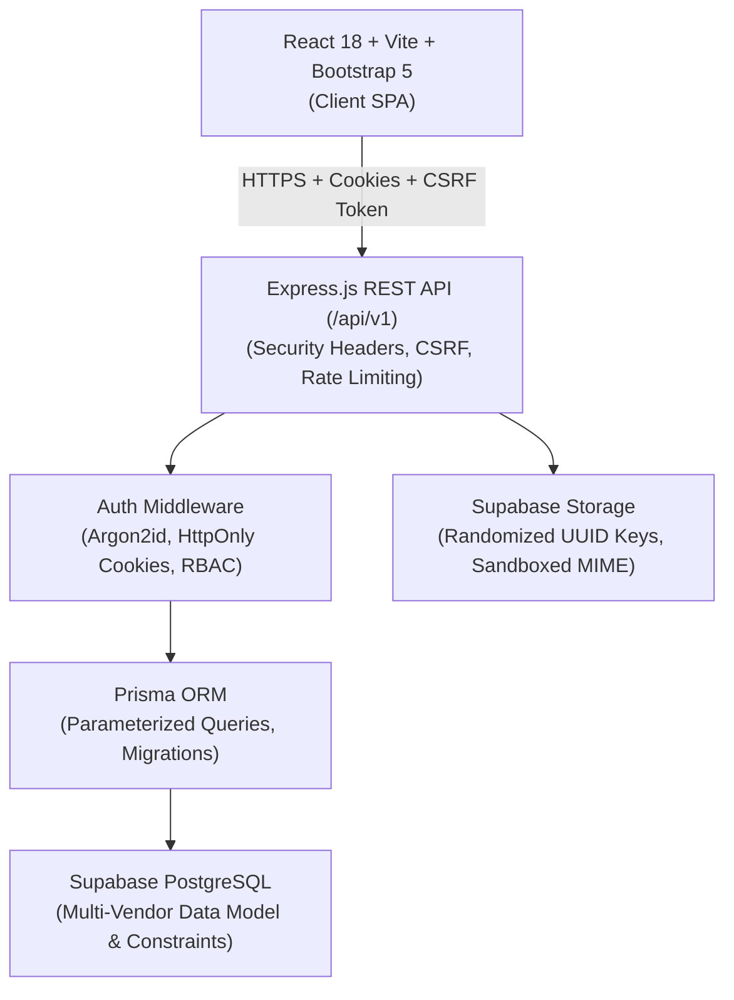

# ARCHITECTURE.md — System Design & Architecture

> **Project**: Gifts Galore — Multi-Vendor Gift Marketplace
> **Date**: 2026-10-12
> **Status**: Approved Baseline

---

## 1. System Overview



---

## 2. Technology Stack & Rationale

| Layer | Choice | Rationale |
|-------|--------|-----------|
| **Frontend** | React 18 + Vite | Fast HMR, component-driven, standards-compliant ecosystem. |
| **Styling & UI** | Bootstrap 5 + Custom CSS Tokens | Responsive grid, accessible primitives, warm cream & terracotta palette. |
| **Routing** | React Router v6 | Declarative client-side routing, protected route guards. |
| **Backend** | Node.js + Express.js | Modular REST structure under `/api/v1`, robust middleware ecosystem. |
| **Validation** | Zod / Joi | Strict runtime input sanitization & type inference on all incoming payloads. |
| **Database** | PostgreSQL on Supabase | ACID transactions, relational integrity, JSONB support for customization schemas. |
| **ORM** | Prisma | Schema-as-code, type safety, repeatable versioned migrations, parameterized queries. |
| **Media Storage** | Supabase Storage | S3-compatible cloud object storage with signed/public URL support and size restrictions. |
| **Security** | Argon2id + Helmet + Cookie-Session + CSRF | Industry-standard password hashing, HTTP security headers, XSS & CSRF mitigations. |
| **Testing** | Vitest / Jest + Supertest | Unit & integration testing across API routes, auth, and state logic. |

---

## 3. Multi-Vendor Data Architecture (Domain Model)

To guarantee true multi-vendor capabilities without hardcoding Gifts Galore:
1. **User**: Base identity model (`CUSTOMER`, `SELLER`, `ADMIN`).
2. **Seller**: One-to-one with User (for seller accounts). Contains store name (`Gifts Galore, Loharu`), slug, contact info, status (`PENDING`, `APPROVED`, `SUSPENDED`).
3. **Product**: Belongs to `Seller`. Specifies `productType` (`READY_MADE`, `CUSTOMIZABLE`, `ON_DEMAND`), `price`, `discountPrice`, `stockQuantity`, `availability` (`IN_STOCK`, `OUT_OF_STOCK`, `MADE_TO_ORDER`), status (`DRAFT`, `PENDING_REVIEW`, `ACTIVE`, `INACTIVE`, `SOFT_DELETED`).
4. **ProductImage**: Belongs to `Product`. Features `imageUrl`, `displayOrder`, `isPrimary`.
5. **ProductVariant**: Optional attributes (e.g., Size, Color, Frame Material) with SKU and price delta.
6. **CustomizationField**: Configured by Seller for a customizable product. Defines `label`, `fieldType` (`TEXT`, `TEXTAREA`, `IMAGE_UPLOAD`, `SELECT`), `isRequired`, `maxLength`, `allowedFileTypes`, `displayOrder`.
7. **Order**: Belongs to Customer. Contains financial summary (`grossAmount`, `discountAmount`, `taxAmount`, `shippingAmount`, `netAmount`), payment status, and direct gifting metadata (`isGift`, `recipientName`, `recipientPhone`, `recipientAddress`, `giftMessage`, `deliveryDateRequested`, `discreetPricingRequested`).
8. **OrderItem**: Line items tied to a `Product` and specific `Seller`. Stores immutable `customizationSnapshot` (JSON) and agreed unit price.
9. **BespokeRequest**: Customer custom gift request tied to target `Seller`. Workflow tracks `status` (`SUBMITTED`, `UNDER_REVIEW`, `QUOTED`, `CUSTOMER_APPROVED`, `ORDER_CREATED`, `REJECTED`, `CANCELLED`), budget range, reference images, quotes, and customer confirmation.
10. **AuditLog**: Immutably records sensitive actions (admin account bans, product removals, seller status shifts).

---

## 4. Application Security Architecture

### Authentication & Sessions
- **Password Hashing**: Argon2id with memory cost 65536 KB, time cost 3, parallelism 1.
- **Session Transport**: HttpOnly, SameSite=`lax` (or `strict`), Secure cookies.
- **CSRF Defense**: Double-submit cookie or server-generated CSRF token checked on all mutating methods (`POST`, `PUT`, `PATCH`, `DELETE`).
- **Session Revocation**: User suspension or logout immediately invalidates the session record/token.

### Authorization & Tenant Isolation
- **RBAC Matrix**: Enforced strictly at the Express route middleware level.
- **Resource Ownership Middleware**: Whenever a seller attempts to access, mutate, or query `/api/v1/seller/*` resources, an ownership check validates `resource.sellerId === req.user.sellerId`.
- **Admin Privilege**: Platform admins have global moderation capabilities; all admin mutations generate an `AuditLog` entry.

### Input Sanitization & File Uploads
- All request parameters, query strings, and request bodies are validated against strict Zod schemas before reaching controllers.
- Uploads pass through Multer with in-memory validation: allowlisted MIME types (`image/jpeg`, `image/png`, `image/webp`), max 5MB, randomized UUID filenames before upload to Supabase Storage.
- No Supabase `service_role` secrets exposed to client browsers.

---

## 5. Repository Layout

```
GiftGlore/
├── .agent/               # GSD Workflows
├── .agents/              # Antigravity Skills & Customizations
├── .gsd/                 # Project Specification, Roadmap, State, and Documentation
│   ├── SPEC.md
│   ├── REQUIREMENTS.md
│   ├── ARCHITECTURE.md
│   ├── ROADMAP.md
│   ├── DECISIONS.md
│   ├── STATE.md
│   └── phases/           # Phase plans & summaries
├── client/               # Frontend SPA (React + Vite + Bootstrap 5)
│   ├── src/
│   │   ├── assets/       # Styles, theme variables, icons
│   │   ├── components/   # Reusable UI widgets (Navbar, Footer, Modals, Forms)
│   │   ├── context/      # AuthContext, CartContext
│   │   ├── pages/        # Storefront, ProductDetails, Cart, Checkout, Dashboards
│   │   ├── services/     # API client layer with Axios / Fetch + CSRF headers
│   │   └── utils/
│   ├── index.html
│   ├── package.json
│   └── vite.config.js
├── server/               # Backend API (Node.js + Express.js + Prisma)
│   ├── src/
│   │   ├── config/       # Environment, Supabase client, logger
│   │   ├── controllers/  # Route handlers
│   │   ├── middleware/   # Auth, RBAC, Ownership, Validation, RateLimit, ErrorHandler
│   │   ├── routes/       # Express route definitions under /api/v1
│   │   ├── services/     # Domain business logic
│   │   ├── validations/  # Zod validation schemas
│   │   └── app.js        # Express app configuration
│   ├── prisma/
│   │   ├── schema.prisma # PostgreSQL Prisma schema
│   │   └── migrations/   # Versioned SQL migrations
│   ├── tests/            # Automated test suite (Supertest + Vitest/Jest)
│   ├── package.json
│   └── server.js         # HTTP server entrypoint
├── .env.example
├── README.md
└── PROJECT_RULES.md
```
